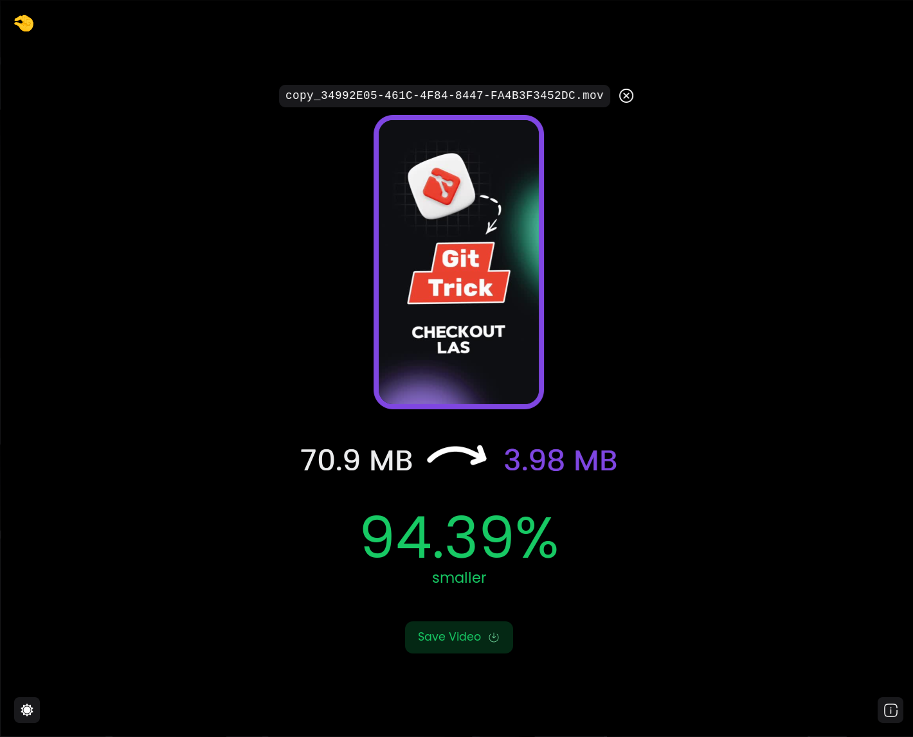
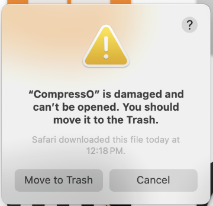
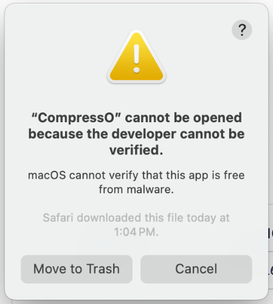
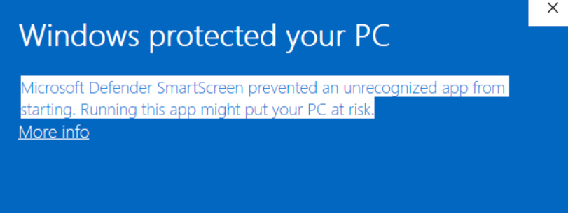

<div align="center">
  <div align="center">
   
  </div>
	<h1 align="center">CompressO</h1>
	<p align="center">
		Compress any video/image into a tiny size.
    </p>
    <i align="center">
		CompressO (🔉 pronounced like "Espresso" ) is a free and open-source video/image compression app.
    </i>
    <br />
    <p align="center">
		Available for <strong>Linux</strong>, <strong>Windows</strong> & <strong>MacOS</strong>.
    </p>
    <br />
	<div>
  <a href="https://github.com/codeforreal1/compressO/releases">
    
  </a>
  <a href="https://github.com/codeforreal1/compressO/releases">
    
  </a>
  <a href="https://github.com/codeforreal1/compressO/releases">
    
  </a>
</div>
	    <br />

</div>
<div align="center">
    
</div>

### Install
Download installers📦 for the specific platform can be accessed from the [releases](https://github.com/codeforreal1/compressO/releases) page.

<strong>Installer Info:</strong>

- `CompressO_amd64.deb`: Debian derivative of Linux like Ubuntu
- `CompressO_amd64.AppImage`: Universal package for all Linux distros
- `CompressO_aarch64.dmg` : For Macbooks with Apple Silicon Chips
- `CompressO_x64.dmg` : For Macbooks with Intel Chip
- `CompressO_x64.msi`: Windows 64 bit

<strong>Homebrew: MacOS only!</strong>
```
brew install --cask codeforreal1/tap/compresso
```

> [!NOTE]
> By using CompressO, you acknowledge that it's not [notarized](https://developer.apple.com/documentation/security/notarizing_macos_software_before_distribution).
>
> Notarization is a "security" feature by Apple.
> You send binaries to Apple, and they either approve them or not.
> In reality, notarization is about paying $100 annual fee to Apple and building the app/binaries the way they want it.
>
> This is a free & open-source app. Paying the annual fee and notarizing the app to appease Apple is not feasible.
>
> The [Homebrew installation script](https://github.com/codeforreal1/homebrew-tap/blob/main/Casks/compresso.rb) is configured to
> automatically delete `com.apple.quarantine` attribute, that's why the app should work out of the box, without any warnings like 
> "CompressO is damaged and can't be opened. You should move it to trash." that Apple show as a gatekeeper.


### Tech

This app is created using [Tauri](https://tauri.app/), a Rust🦀 framework for building a cross-platform desktop app. It uses [React](https://react.dev) powered by [Vite](https://vite.dev/) as a frontend layer. The compression is done entirely by 3rd part tools like [FFmpeg](https://ffmpeg.org/), [pngquant](https://pngquant.org/), [jpegoptim](https://github.com/tjko/jpegoptim), [gifski](https://gif.ski/), etc. using platform specific standalone binaries.
The app works completely offline and no any network requests is made to/from the app(except for built-in app updates).

### Building
Make sure [Rust](https://rust-lang.org/) & [Node.js](https://nodejs.org/) toolchains are installed.

Local Development:
- Start Tauri server
```
pnpm tauri:dev 
```
- Start Vite server:
```
pnpm vite:dev
```

Production Build:
```
pnpm tauri:build
```

### Screenshots
<details>
<summary>
  <strong> 
 	View app screenshots
  </strong>
</summary>
	
	
	
	
	
	
	
	
</details>

### FAQs
<details>
<summary>
  <strong> 
  MacOS: "CompressO" is damaged and can't be opened. You should move it to trash. 
  </strong>
</summary>

<p>
  This error is shown by Apple to gatekeep app developers from using their apps unless it's signed by Apple after paying $100/year fee. The message is completely misleading since the app is not damaged at all. Since this is a free app, I'm not going to go Apple's route just to appease them to make people trust my app. Here's a simple solution for this issue. Open your terminal and run the command:
</p>

```
xattr -cr /Applications/CompressO.app
```
<p>
  This error will not show if you install the app via Homebrew.
</p>
<p>
  If you don't feel comfortable applying the above solution, you can simply move the app to trash (which also means you cannot use CompressO on your Mac).
</p>
</details>
<details>
<summary>
  <strong>MacOS: "CompressO" cannot be opened because developer cannot be verified.</strong>
</summary>

<p>
  This error is essentially the same as FAQ 1. Apple just displays a different message to warn users about unverified developers. Please refer to the solution in FAQ 1:
</p>
<pre><code>
xattr -cr /Applications/CompressO.app
</code></pre>
<p>
  This error will not show if you install the app via Homebrew.
</p>
<p>
  If you don’t want to run the command, you can right-click the app and select "Open" to bypass the warning, or move the app to trash.
</p>
</details>

<details>
<summary>
  <strong>Windows: Microsoft Defender SmartScreen prevented an unrecognized app from starting. Running this app might put your PC at risk.</strong>
</summary>

<p>
  This happens because you downloaded the Windows installer from an outside source. Windows Defender warns you before running any unknown app. You can safely install CompressO by clicking "More Info" and then selecting "Run Anyway".
</p>
</details>

### License 🚨

The project is licensed under <a href="./LICENSE">AGPL 3.0</a>

This project bundles and uses third-party software. For complete third-party notices, licenses, and attributions, please see [THIRD_PARTY_NOTICES.md](./THIRD_PARTY_NOTICES.md).
